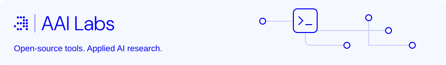
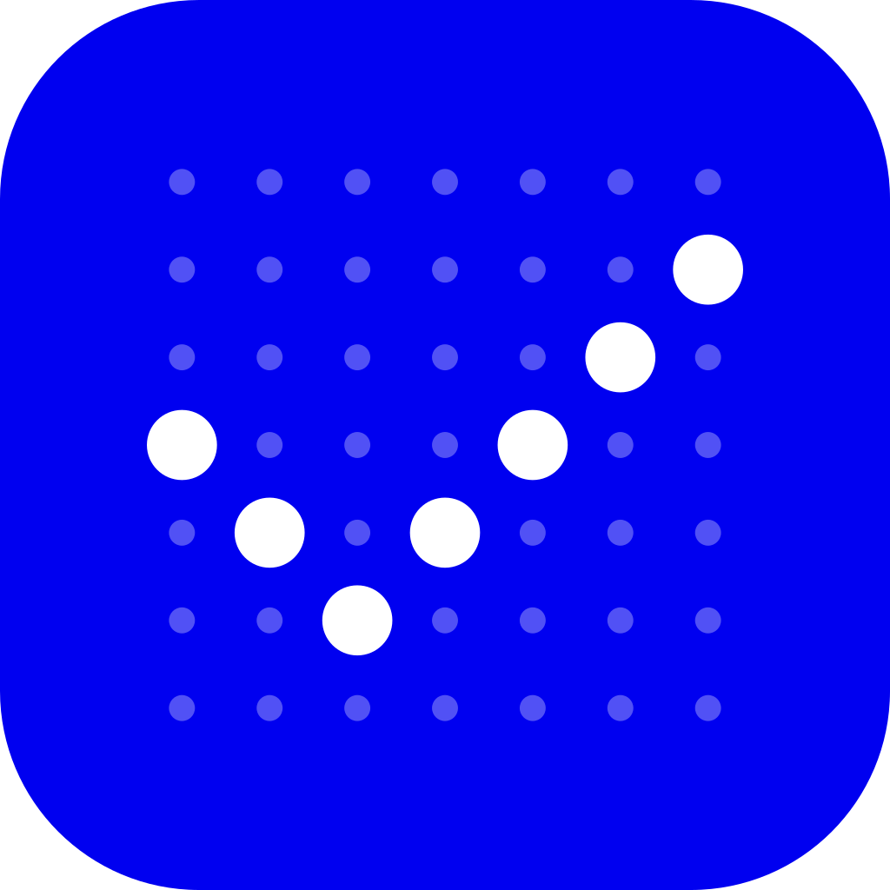

<picture>
  <source media="(prefers-color-scheme: dark) and (max-width: 600px)" srcset="https://raw.githubusercontent.com/aai-labs/.github/main/profile/assets/header-mobile-dark.svg">
  <source media="(max-width: 600px)" srcset="https://raw.githubusercontent.com/aai-labs/.github/main/profile/assets/header-mobile-light.svg">
  <source media="(prefers-color-scheme: dark)" srcset="https://raw.githubusercontent.com/aai-labs/.github/main/profile/assets/header-dark.svg">
  
</picture>

We build and share tools for AI agents, developer workflows, and model evaluation. AAI Labs is an AI engineering and research company in Vilnius, Lithuania, working on applied AI since 2018.

[Open source](#open-source) · [Research](#applied-research) · [Products](#products) · [About us](#what-we-do) · [Selected projects](#selected-projects)

## Open source

Find a tool, try it locally, or contribute to the code.

###  Agent Barn

Run AI agents in your own Kubernetes cluster, with access controls, per-agent costs, and audit logs.

[Source code](https://github.com/aai-labs/agent-barn) · [Quick start](https://agentbarn.dev/guides/get-started/local-quickstart) · [Documentation](https://agentbarn.dev/guides)

###  AAI CLI

Give agents and automation a consistent JSON interface to Jira, GitHub, email, calendars, and other business tools.

[Source code](https://github.com/aai-labs/aai-cli) · [Quick start](https://github.com/aai-labs/aai-cli#quick-start) · [Command reference](https://github.com/aai-labs/aai-cli/blob/main/docs/aai-cli-command-reference.md)

###  Tickmark

Evaluate AI agents that build financial models in Excel. Check the answers, trace the formulas, and test what happens when inputs change.

[Source code](https://github.com/aai-labs/Tickmark) · [Get started](https://github.com/aai-labs/Tickmark#quick-start) · [Methodology](https://github.com/aai-labs/Tickmark/blob/main/docs/methodology.md)

| More tools | Use it for |
| --- | --- |
| [**AI Starter**](https://github.com/aai-labs/ai-starter) | Bootstrap AI coding agents with shared development guidelines. |
| [**AAI Alertmanager UI**](https://github.com/aai-labs/aai-alertmanager-ui) | Review Prometheus alerts with critical issues first and less noise. |

Explore our [models and datasets on Hugging Face](https://huggingface.co/aai-labs). For bugs, ideas, or contributions, start with the relevant repository's issue tracker and contribution guidance.

---

## Applied research

Practical evaluations and research from the engineering problems we work on. A few starting points:

- [**Memory Under Noise**](https://www.aai-labs.com/en/research/memory-under-noise): how AI-assistant memory systems retain evidence as conversation histories grow.
- [**Local LLM Benchmark: Administrative Tasks**](https://www.aai-labs.com/en/research/local-llm-benchmark-administrative-tasks): 13 locally run models evaluated across 21 office tasks.
- [**Temporal Conflict Resolution in Legal RAG**](https://www.aai-labs.com/en/research/temporal-conflict-resolution-legal-rag): retrieval design when current and superseded legal sources conflict.

[Browse all research and evaluations →](https://www.aai-labs.com/en/research)

---

## Products

Software we build and operate for teams putting AI to work:

| Product | What it does |
| --- | --- |
| [AgentBarn](https://agentbarn.dev) | Run and manage AI agents on your own infrastructure, with per-agent costs and audit logs. |
| [Merkys.ai](https://www.merkys.ai) | An AI assistant that answers questions from internal documents and relevant law, with source references and on-premises deployment. |
| [CargoBroker](https://www.cargobroker.ai) | An AI freight-booking agent that contacts carriers, compares offers, and prepares booking documents for approval. |
| [AI Scan](https://scan.aai-labs.com) | Find opportunities for AI adoption by interviewing employees about their daily work. |
| [GradeInstant](https://www.gradeinstant.com) | Help lecturers assess students' understanding through questions about their submitted code. |

See [all products and ways to work with us](https://www.aai-labs.com/en/products), including dedicated AI engineering teams and workshops.

---

## What we do

We work on problems across language, speech, vision, and structured data:

- **Generative AI and agents:** document search, knowledge assistants, and automation connected to business tools and workflows.
- **Speech and language:** speech recognition, speech synthesis, and AI for low-resource languages, including Lithuanian.
- **Computer vision:** object detection, industrial quality control, transport monitoring, and drone applications.
- **Predictive modelling and optimisation:** credit scoring, demand forecasting, logistics planning, and data analytics.

Our work spans healthcare, manufacturing, finance, transport, energy, and public services. We build around each organisation's data, infrastructure, and operating requirements, from model development to integration and deployment.

Explore our [services](https://www.aai-labs.com/en/services) and [projects in practice](https://www.aai-labs.com/en/cases).

## Selected projects

- **Manufacturing: CAD quality checks for DIAB.** Inconsistent DXF and CNC files required manual review. We built automated error detection and nesting optimisation; the project reported 95% accuracy in cut-angle detection and 90% accuracy in cut-position identification within panels. [Read the manufacturing case study](https://www.aai-labs.com/en/cases/diab).
- **Transport: a connected pilot in Vilnius.** With JUDU, the municipality, and partners, we combined edge AI and 5G for traffic, road, and passenger monitoring across five buses, five intersections, and five bus stops. The pilot reported 97.9% vehicle-detection precision. [Read the transport case study](https://www.aai-labs.com/en/cases/transport).
- **Healthcare: FTIR analysis with Santaros Klinikos.** We developed a prototype to help interpret kidney-stone spectra, addressing slow manual analysis. The case study reports a reduction in analysis time of up to 80%. [Read the healthcare case study](https://www.aai-labs.com/en/cases/kidney-stones).

These figures describe the individual projects; the linked case studies provide their context and scope.

---

## Work with us

We build custom AI systems for businesses, public institutions, and governments across Europe and beyond. Have a project in mind or want to collaborate on research?

- **Projects and partnerships:** [Contact us](https://www.aai-labs.com/en/contact) or email [hello@aai-labs.com](mailto:hello@aai-labs.com).
- **Careers:** explore [open roles on LinkedIn](https://www.linkedin.com/company/aai-labs/jobs/).

[Company website](https://www.aai-labs.com/en/home) · [LinkedIn](https://www.linkedin.com/company/aai-labs/)
